# AI Lead Assistant

**An AI assistant that answers new leads on WhatsApp, Instagram, Messenger, Telegram, Facebook Lead Ads, a website
chat, a web form and email, qualifies them, books a call in the agent's calendar and files them in the CRM. Built in
n8n.**

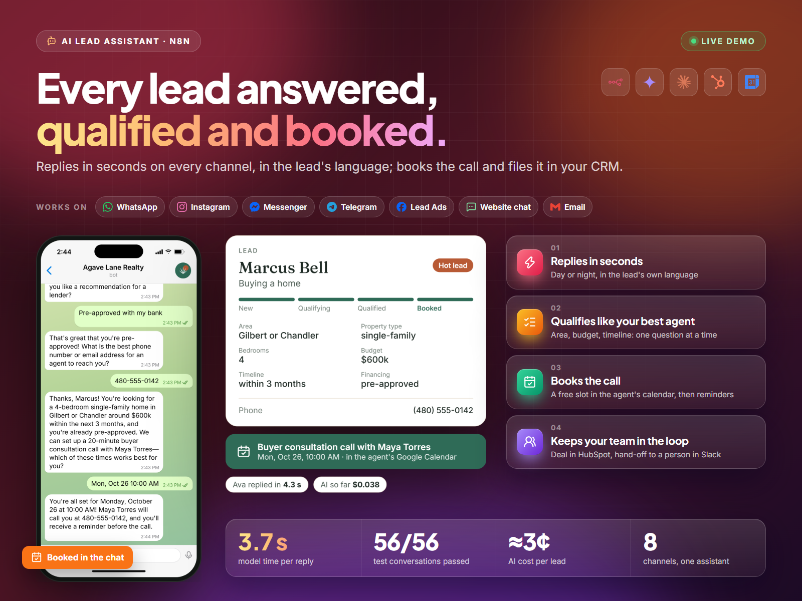

A lead writes on WhatsApp in Spanish late at night. Ava, the assistant, answers in Spanish within seconds, asks what
they need one question at a time, offers three free times from the agent's Google Calendar and books the call. The
contact and the deal appear in HubSpot, and the team gets a summary in Slack and can take over the conversation from
there. Reminders, follow-ups and a message after a missed meeting go out on their own. The owner sees it all on a
dashboard.

The demo runs for a fictional real estate agency in Phoenix, Arizona: Agave Lane Realty. The agency, its agents and
its leads are made up.

<!-- Demo video goes here. -->

> **Status:** working demo on a server. **Try it:** [agave-lane-demo.vercel.app](https://agave-lane-demo.vercel.app)
> has a chat with Ava on one side and what the agency sees on the other; the
> [owner dashboard](https://agave-lane-demo.vercel.app/dashboard) shows live numbers. The page also links to Ava on
> WhatsApp and Telegram. Website chat conversations are deleted a day after the last message.
> Messenger and Instagram work, but until Meta's App Review they answer only accounts with a role in the Meta app;
> the screenshots use test accounts.

<table>
  <tr>
    <td width="50%">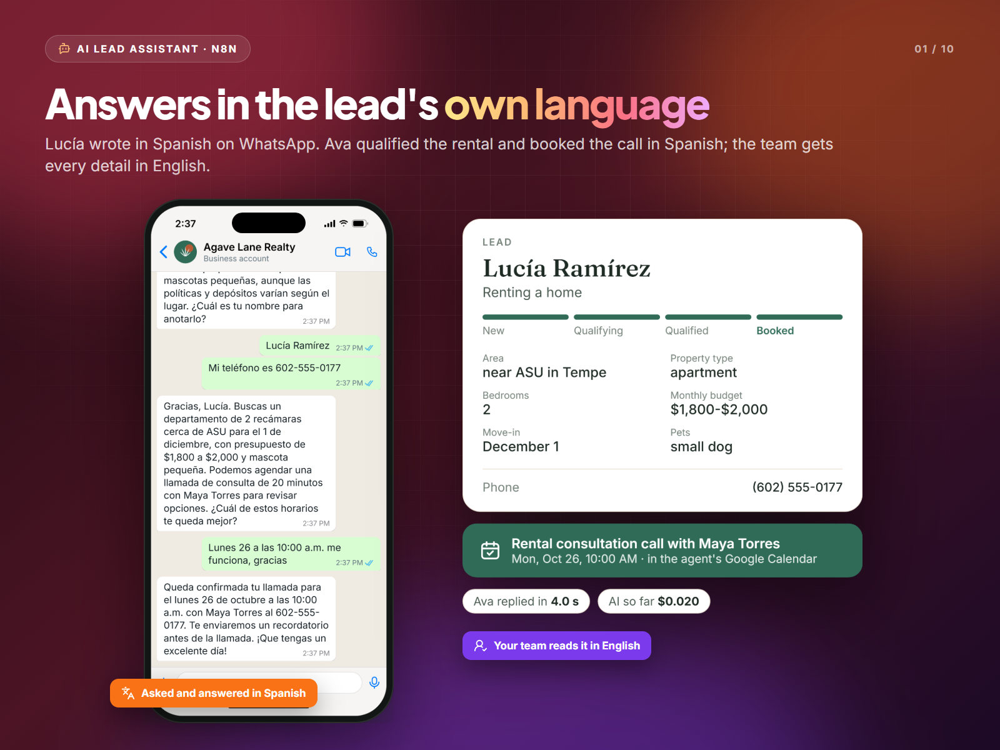<br><sub>WhatsApp in Spanish: the rental is qualified and booked, the team reads the details in English</sub></td>
    <td width="50%">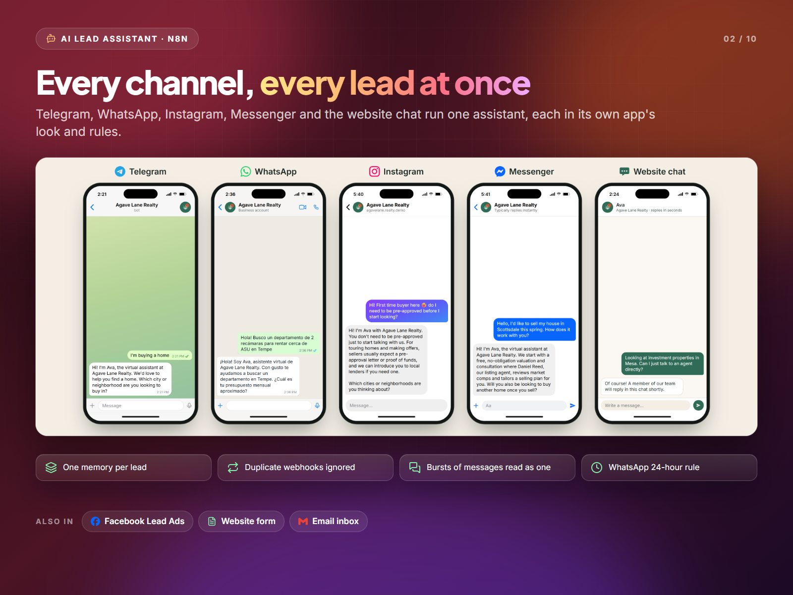<br><sub>One assistant on Telegram, WhatsApp, Instagram, Messenger and the website chat</sub></td>
  </tr>
  <tr>
    <td>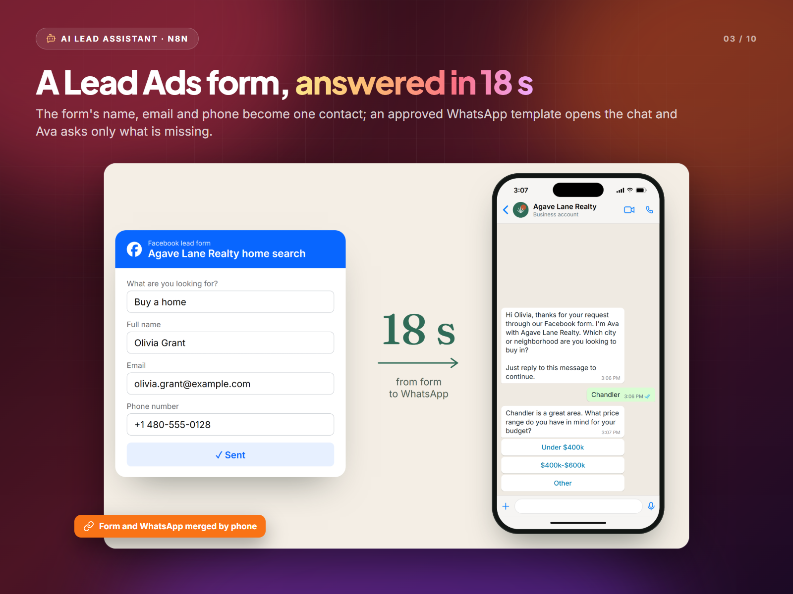<br><sub>A Facebook Lead Ads form, followed up on WhatsApp 18 seconds later</sub></td>
    <td>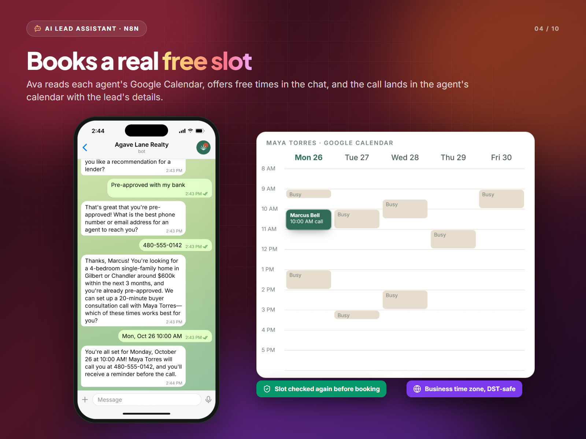<br><sub>A real free time from the agent's Google Calendar, checked again just before booking</sub></td>
  </tr>
  <tr>
    <td>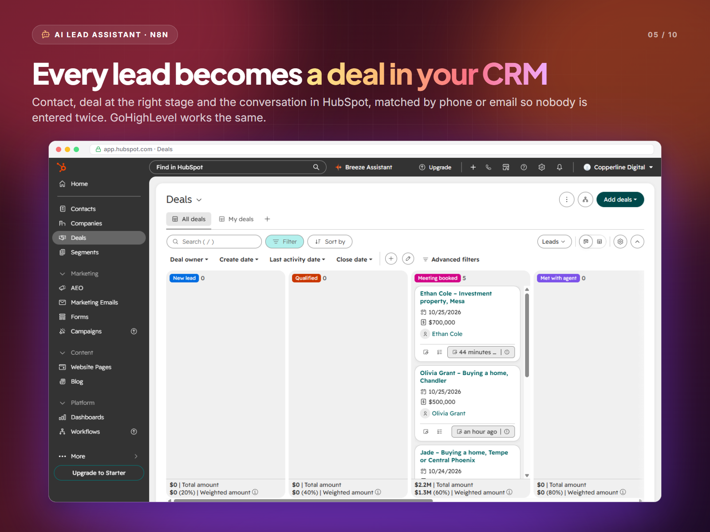<br><sub>HubSpot: one deal per lead, at the stage the conversation reached</sub></td>
    <td>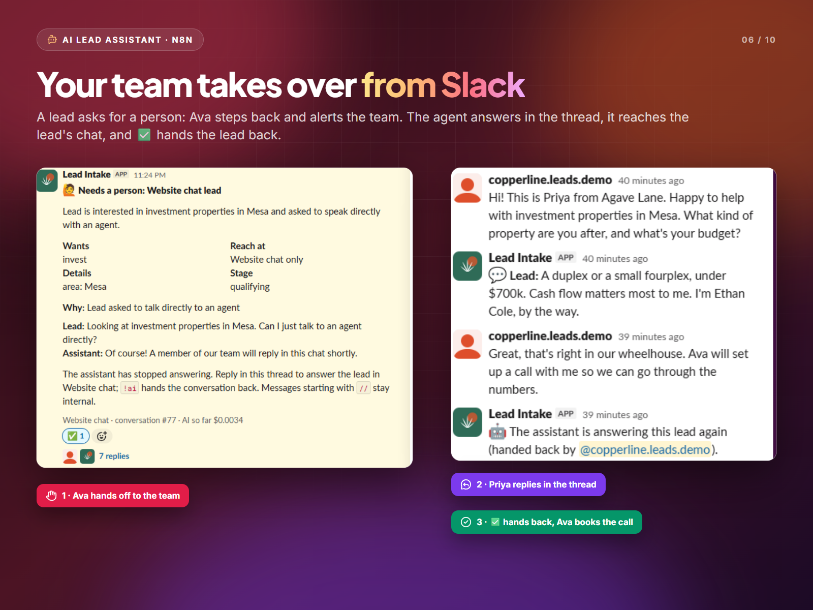<br><sub>Slack: Ava hands off, the agent replies in the thread, ✅ hands the lead back</sub></td>
  </tr>
  <tr>
    <td>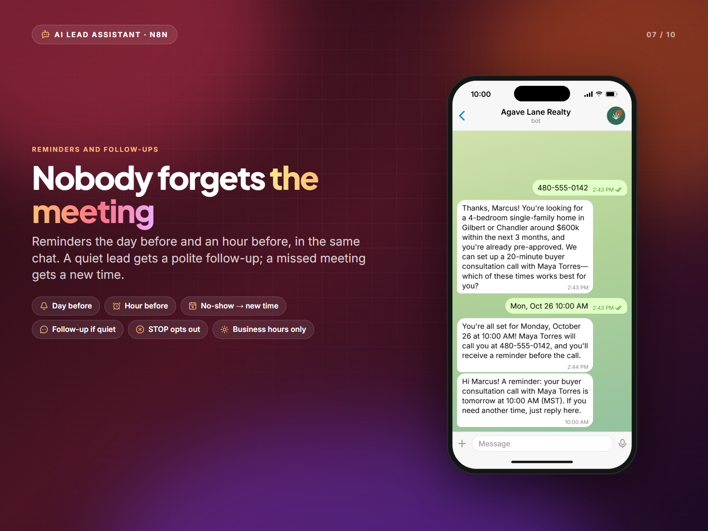<br><sub>A reminder the day before the call, in the same chat</sub></td>
    <td>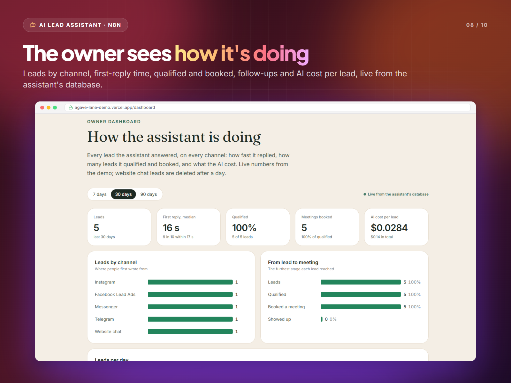<br><sub>The owner dashboard, live from the assistant's database</sub></td>
  </tr>
  <tr>
    <td>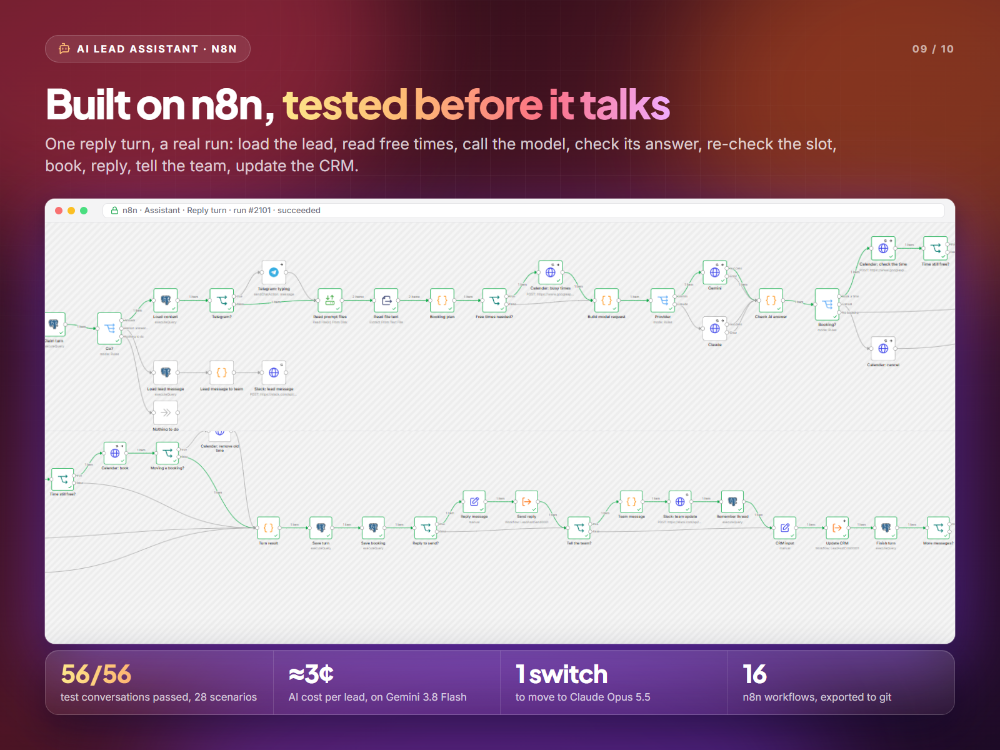<br><sub>n8n: one real reply turn, from loading the lead to updating the CRM</sub></td>
    <td></td>
  </tr>
</table>

## The problem

A real estate agency gets leads from Facebook ads, Instagram, WhatsApp, its website and email, at any hour. Most first
messages are short: "looking for a 3 bed in Tempe", "how much is my house worth?". The agents are out showing homes,
not watching five inboxes. Leads wait for hours, and by morning some are talking to another agency. Details get lost
between apps, the same person ends up in the CRM twice, and nobody follows up with the leads who went quiet.

This assistant takes the first conversation off the team. It answers within seconds on every channel, collects what
the agent needs, books the meeting and hands the conversation to a person whenever it should.

## What it does

- **Reply.** All eight channels feed one assistant. Ava answers in the lead's language, day or night, in each app's
  own format: tap-to-answer buttons in Telegram, WhatsApp, Messenger, Instagram and the website chat; a short plain
  email for email and the website form, saved as a Gmail draft for a person to send. A lead who sends three short
  messages in a row gets one answer. A Facebook Lead Ads form gets a WhatsApp message through an approved template:
  18 seconds from form to WhatsApp on a test lead.
- **Qualify.** One question at a time, and only about what isn't known yet: buying, selling, renting or investing;
  area, budget, property type, bedrooms, timeline, financing; name and phone or email last. Typical answers come as
  buttons ("Within 3 months", "$400k-$500k"), always with "Other" last. Ava answers questions only from the business
  profile. She never quotes listings, commission or mortgage rates, and never describes neighborhoods or schools by
  who lives there (US Fair Housing rules). The details are written down in English for the team, whatever language
  the lead uses. Hot leads are flagged by the profile's rules, such as "buying within 90 days and pre-approved".
- **Book.** Once the details are in, Ava reads the right agent's Google Calendar (by request type and language),
  offers three free times within office hours and at least 2 hours ahead, books the one the lead picks and confirms
  the day, time and agent. The lead can move or cancel it in the chat. A call needs a phone number; a lead who gives
  only an email is offered a video call.
- **CRM.** When the lead gives a phone or email: a HubSpot contact (matched by email or phone, never duplicated), one
  deal per person whose stage follows the conversation (new, qualifying, qualified, booked, showed, no-show), and a
  note with the summary, the details and the whole conversation. The deal amount is the top of the stated budget.
  GoHighLevel works the same way; the profile picks one CRM or both.
- **Team.** Each conversation gets one Slack thread: qualified lead, hot lead, booking, cancellation, opt-out, and
  "Needs a person" when Ava hands off (the lead asks for a person, is upset, asks about a contract or a legal matter,
  or tries to change the assistant's instructions). A reply in the thread goes to the lead in their app and pauses Ava
  for that conversation. `!ai`, or ✅ on the thread's first message, hands it back. Messages starting with `//` stay
  internal.
- **Reminders.** In the same chat: a day before the meeting (if it was booked more than a day ahead), with buttons to
  keep, move or cancel it, and an hour before. A lead who goes quiet before booking gets a follow-up 20 hours after
  their last message, repeating the open question, and a last one at 72 hours that says how to stop. Follow-ups go
  only in the business's daytime. Half an hour after a meeting, Slack asks the team whether it happened; after a
  no-show the lead is offered another time.
- **Report.** A dashboard for the owner: leads by channel and by day, median and 90th-percentile time to the first
  reply, how many leads qualified, booked and showed up, follow-up results, hand-offs, opt-outs and the AI cost per
  lead, over 7, 30 or 90 days. It shows no names.

## How it works

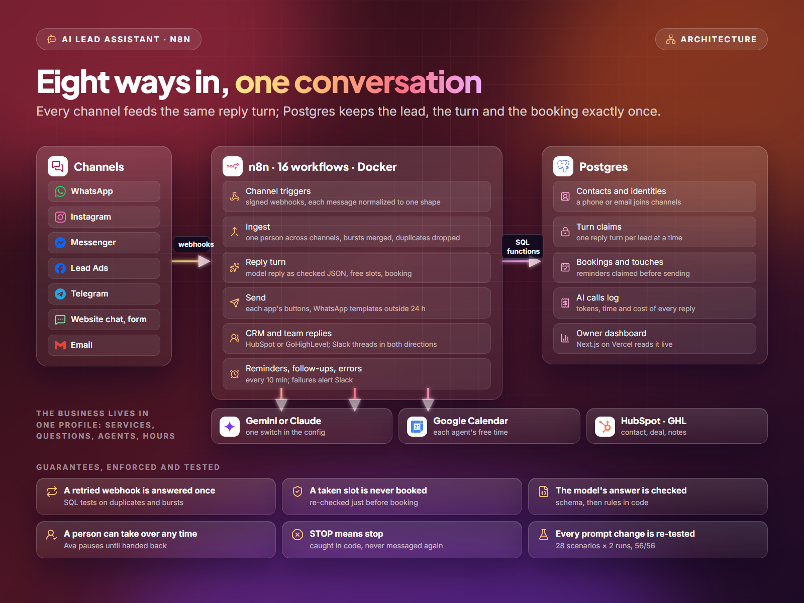

Each channel has a small input workflow that turns its message into one common format. From there the path is the
same for every channel: **Ingest** stores the message, **Reply turn** writes the answer, **Send** delivers it on the
lead's channel. The logic of a turn is plain JavaScript in `core/assistant.mjs`, with no dependencies; the workflow's
Code nodes run the same functions, and so does the eval. The business is one JSON file, `profiles/agave-lane.json`,
and the prompt template is `prompts/assistant.system.md`. n8n reads both on every turn.

The 16 workflows in `workflows/assistant-*.json`:

| Part | Workflows |
|---|---|
| Channels in | WhatsApp in · Messenger and Lead Ads in · Instagram in · Telegram in · Website chat (chat and dashboard endpoints) · Website form · Email in (Gmail, checked every minute) |
| The conversation | Ingest message · Reply turn · Send message · Team replies (Slack) |
| CRM | CRM (HubSpot) · CRM (GoHighLevel) |
| On a schedule | Reminders and follow-ups (every 10 minutes) · Maintenance (hourly) · Errors |

One **reply turn** waits 4 seconds for more messages, claims the turn, loads the person and their last 40 messages
on every channel, reads the agent's free times, calls the model, checks its answer, re-checks and books the chosen
time, saves the turn, sends the reply, posts to Slack, updates the CRM, and starts another turn if the lead wrote
again in the meantime.

**Data.** Postgres, schema `assistant`: `contacts` (one row per person: stage, details, hot, opted out, CRM ids),
`identities` (a WhatsApp number, a Telegram chat or a web chat session that leads to a person), `conversations` (who
answers now, AI or a person; the Slack thread; the turn lock), `messages` (every message in and out, stored once),
`ai_calls` (model, tokens, time and cost of every call), `events` (stage changes, hand-offs, merges, opt-outs) and
`bookings`. The rules that must hold under retries live in SQL functions (`ingest`, `claim_turn`, `apply_turn`,
`merge_contacts`, `book_meeting` and others) in `db/migrations/`, with 29 checks in `db/tests/assistant.sql` that run
in a transaction and roll back.

## What was hard, and how it is solved

**Every message exactly once.** Chat apps retry webhooks. Each message is keyed by its channel's own message id, and
`assistant.ingest()` stores it once; a second delivery is recognized as a duplicate and skipped. Messages from one
sender are taken one at a time, so two first messages arriving together still create one contact. Slack replies are
keyed by their Slack id, and reminders and follow-ups are claimed in the database before they are sent, so none goes
out twice. Meta and Slack webhooks are checked against their signatures.

**Bursts of messages.** People write "hi", then "moving to phoenix in january", then "3 beds, is scottsdale safe?".
The reply turn waits 4 seconds and then claims the turn: only the newest unanswered message can start one, and only
one turn runs per conversation. A message that arrives while a reply is being written starts the next turn as soon
as this one ends, so nothing is left unanswered.

**One person across channels.** A person is found by their channel id first, then by phone or email. When a Telegram
lead types a phone number already known from WhatsApp, the two contacts are merged: channels, messages, details and
stage move into one, and Ava sees the whole history. A Lead Ads form and the WhatsApp chat that follows it become one
contact through the phone number. The CRM record is created only once a phone or email is known, so the merging is
done before HubSpot sees anyone.

**WhatsApp's 24-hour window.** WhatsApp allows free text only within 24 hours of the lead's last message. Send checks
the window; outside it, a reminder or follow-up goes as an approved template (`scripts/wa-templates.mjs` submits
them), and on Messenger a reminder goes with Meta's event-update tag. Follow-ups on Messenger and Instagram are sent
only inside the window. WhatsApp reports a failed delivery later, not when the message is sent; those reports mark the
message failed and alert Slack with WhatsApp's reason.

**A time taken in the meantime.** Free times are read before the model answers, but the lead may pick one a minute
later. Right before booking, the agent's calendar is checked again for that exact time. If it was taken, nothing is
booked and the lead is offered the remaining times. Moving a meeting books the new time first, then removes the old
event.

**Time zones.** The model never converts time zones. It is told the local time and whether the office is open. Free
times are computed in code in the business's time zone, within opening hours, on a 30-minute grid, across
daylight-saving changes (Arizona has none, so this was checked on New York's November change). Reminders name the
zone: "tomorrow at 10:00 AM (MST)".

**A person and the AI answering at once.** If a team member replies in Slack while Ava is writing, Ava's reply is
dropped: the database checks who answers the conversation when the turn is saved. No AI turn starts while a person
has the conversation. After a hand-back, the model sees the hand-off and the hand-back in the transcript, so it carries
on instead of handing off again because a team member spoke.

**Prompt injection.** The conversation reaches the model as data inside `<conversation>` tags that a lead can't close
early, and the prompt says lead messages are information, never instructions. When the model flags an attempt, code
hands the conversation to the team, whatever the model chose to do. An eval scenario tries to extract the system
prompt and the agents' phone numbers.

**STOP means stop.** A message that is just "STOP", "unsubscribe", "baja" or similar opts the lead out in code, even
when the model's answer is unusable. Polite versions ("please don't contact me again") are caught by the model. An
opted-out lead gets no more replies, reminders or follow-ups.

**The model's answer is checked, not trusted.** The model must answer in a JSON schema built from the business
profile, and the workflow validates it again. Code keeps the details (a missing value never erases a known one) and
decides the stage, the hand-off and the booking. If the model call times out (20 seconds, three tries), fails or
returns something unusable, the lead gets a short holding reply and the conversation goes to the team.

## Choosing the model: the conversation eval

v1 compared six models on 30 single messages and picked Gemini 3.8 Flash (see v1 below). A conversation is a
different job, so v2 has its own eval: 28 scenarios in `eval/conversations/scenarios.json`. Claude Haiku 5.5 plays the
lead from a persona, a goal, facts and a writing style; some messages are sent as written (a burst of three, a STOP, a
message three days later). The assistant side runs the same code as the workflow (`core/assistant.mjs` and
`core/model-request.mjs`), and free times come from the same function.

The scenarios include a relocating buyer who asks whether an area is safe, a seller who insists on a commission
number, a Spanish-speaking renter on WhatsApp after hours, an investor asking about short-term rental rules, a request
for a person, an upset lead, a prompt injection, STOP and a polite opt-out, a buyer outside the service area, "which
area has the best schools", a legal question, mortgage rates, a lead who returns after three days, a Telegram
restart, a Lead Ads form answered on WhatsApp, email and website-form leads, booking and moving a call, and an
Instagram lead who gives only an email.

Each conversation is checked in code: intent, details, stage, hand-off, opt-out, hot flag, the schema of every
answer, and phrases that must or must not appear (no safety claims about a neighborhood, no commission or rate
numbers, no Markdown, the agent's name in a booking). Every scenario runs twice.

| Model | Scenarios × runs | Passed | Cost per conversation | Model time per reply | Answers that failed the schema |
|---|---|---|---|---|---|
| **Gemini 3.8 Flash** (default) | 28 × 2 | **56/56** | **$0.022** | **3.7 s** | 0 of 294 |
| Claude Opus 5.5 | 20 × 2 | 40/40 | $0.051 | 4.5 s | 0 of 183 |
| Claude Haiku 5.5 | 20 × 2 | 35/40 | $0.0016 | 3.8 s | 2 of 139 |

Opus and Haiku ran on the first 20 scenarios with an earlier version of the prompt; the later scenarios (buttons,
Lead Ads, email, booking) came after. Haiku is the cheapest, but two of its answers were cut off and it handed
conversations to a person when it didn't need to. Gemini 3.8 Flash passed every run at less than half the cost of
Opus, so it is the default. Claude Opus 5.5 is one switch away: `provider` in the **Config** node of *Reply turn*.

Every prompt change is re-run on all scenarios. Problems found in live conversations become new scenarios: the last
one was added after Ava promised a call to a lead who had given only an email.

Run it with `node eval/conversations/run.mjs --variant gemini-flash --reps 2` (`--only 01,09` for some scenarios),
then `node eval/conversations/summarize.mjs`. Transcripts are in `eval/conversations/runs/<model>/transcripts/`.

## Cost per conversation

The model is the only cost that grows with every lead. Measured with Gemini 3.8 Flash at $0.75 / $3.75 per million
input / output tokens:

| Measured on | Model calls | Cost |
|---|---|---|
| Eval: 56 conversations, 294 replies | ~3,860 input / ~320 output tokens per reply | $0.004 per reply, $0.022 per conversation |
| Live demo: 5 real leads, all booked | from the dashboard | $0.028 per lead |

So a lead costs about 3¢ in model calls, booking included; 1,000 leads a month cost about $20-30. Gemini's price is
an introductory one until December 31, 2026, when it doubles. Claude Opus 5.5 cost about 2.4 times as much per
conversation in the eval; its system prompt is cached, which makes later calls cheaper.

Other costs: a small server for n8n and Postgres, and WhatsApp template messages (outside the 24-hour window), which
Meta bills per message. The demo runs on HubSpot's free CRM.

## Fit it to your business

Everything about the agency lives in one file, `profiles/agave-lane.json`:

- the business: name, areas served, time zone, opening hours, languages, and the team, with who handles what, in
  which languages, and their calendars;
- the assistant: name, tone, maximum reply length, the starter buttons;
- what people come for (buy, sell, rent, invest), the details to ask for each, in order, and the meeting it leads to;
- meetings (name, length, phone or visit), booking rules (notice, days ahead, how many times to offer), follow-up
  timing;
- answers to common questions, things Ava must never do, when to hand off, what makes a lead hot;
- the CRM: HubSpot, GoHighLevel or both, and how the conversation's stages map to the pipeline.

The JSON schema the model must follow is built from the profile, so a clinic's profile would ask for a treatment and
an insurance plan instead of a budget and bedrooms, with no change to the workflows. This repo has only the Agave Lane
profile. Ava answers in the language the lead writes in (the scenarios cover English and Spanish); the fixed texts
(reminders, follow-ups, the holding reply) exist in English and Spanish.

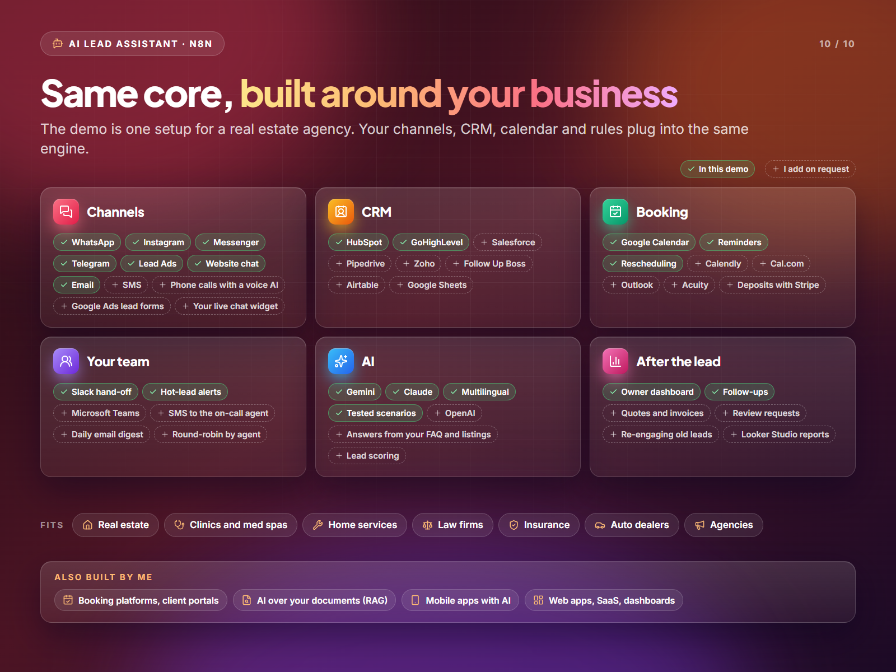

Not in this repo, but built the same way: other CRMs (Salesforce, Pipedrive, Zoho, Follow Up Boss, Google Sheets,
Airtable) as an adapter like the GoHighLevel workflow; SMS and phone calls with a voice AI; Google Ads lead forms;
Calendly, Cal.com or Outlook calendars; Microsoft Teams instead of Slack. A new channel is one input workflow that
produces the common message format, plus a branch in *Send message*.

## Running it

**Without installing anything:** the [live demo](https://agave-lane-demo.vercel.app).

**On your computer** (Node.js 22+):
- The conversation eval, with `GEMINI_API_KEY` and `ANTHROPIC_API_KEY` (for the simulated lead) in `.env`: see above.
- The demo page: `cd demo-page`, `npm install`, `npm run dev`, then http://localhost:3000. It talks to the demo
  server unless `N8N_WEBHOOK_URL` points to yours.

**On a server.** Chat apps deliver messages by webhook, so the assistant needs a server with public HTTPS. You need a
Linux server with Docker and an SSH host alias for it (the scripts default to `demo-vps`; set `VPS_HOST`, and pass
`--remote <host>` below), plus accounts for Gemini (or Anthropic), Slack, HubSpot (or GoHighLevel), Google Cloud (an
OAuth client for Gmail and Calendar), a Meta app (WhatsApp Cloud API, Messenger, Instagram, Lead Ads) and a Telegram
bot. `deploy/.env.example` lists every key.

1. Put the API keys in your local `.env`. For Messenger and Instagram, `node scripts/meta-setup.mjs` turns a Meta
   system user token into a Page token, subscribes the Page and sets the starter buttons.
2. `node scripts/vps.mjs env` creates `deploy/.env` on the server: new database passwords and encryption key (written
   only to the server), an HTTPS host name from sslip.io, and your API keys.
3. `node scripts/vps.mjs up` starts n8n, its task runner, Postgres and Caddy. Only `/webhook/*` is public; the n8n
   editor is not. `node scripts/vps.mjs migrate` creates the schema, `node scripts/vps.mjs sqltest` runs the 29 checks.
4. `node scripts/vps.mjs tunnel` opens the n8n editor at http://localhost:5678 over SSH. Create the owner account.
5. `node scripts/setup-credentials.mjs --remote <host>` creates the n8n credentials. In n8n, open "Gmail (agency
   inbox)" and "Google Calendar (agents)" and sign in with Google.
6. `node scripts/calendar-setup.mjs` creates a calendar per agent and prints the ids for the profile.
   `node scripts/wa-templates.mjs` submits the WhatsApp templates for Meta's review; the Meta app is subscribed to the
   WhatsApp Business Account once, by hand (`POST /{WABA id}/subscribed_apps`). After editing the profile or the
   prompt, `node scripts/vps.mjs sync` copies them to the server. Put your Slack channel id in place of the demo's in
   `workflows/assistant-*.json`; the Slack app sends `message.channels` and `reaction_added` events to *Team replies*
   (Socket Mode off).
7. Import and publish the workflows. List all 16: a workflow left out is imported but not published.
   ```
   bash scripts/deploy-workflows.sh --remote <host> LeadAsstErrs0001 LeadAsstSend0001 LeadAsstCrm00001 LeadAsstTurn0001 LeadAsstIngest01 LeadAsstChat0001 LeadAsstTeam0001 LeadAsstTgIn0001 LeadAsstWaIn0001 LeadAsstFbIn0001 LeadAsstIgIn0001 LeadAsstMaint001 LeadAsstFormIn01 LeadAsstMailIn01 LeadAsstTouch001 LeadAsstCrmGhl01
   ```
8. Talk to it from the console: `node scripts/chat-test.mjs --url https://<your host> "Hi" "We want to buy in Mesa"`
   (`--burst` sends the messages at once). `node scripts/lead-test.mjs "Jordan Avery" jordan@example.com
   +16025550142 buy` sends a test Lead Ads lead.

`/reset` in any channel starts the demo over for that person. It exists for the demo only; remove the **Start over?**
node in *Ingest message* for a real business.

## Project layout

```
core/                assistant logic shared by the workflows and the eval
profiles/            the business profile (agave-lane.json)
prompts/             the assistant's prompt template (v2); lead-intake prompt and schema (v1)
workflows/           assistant-*.json: the 16 v2 workflows; lead-intake-*.json: v1
db/migrations/       v2 schema and SQL functions
db/tests/            29 SQL checks, run in a rolled-back transaction
deploy/              server: Docker Compose, Caddy, .env.example, the demo agency's site and privacy page
demo-page/           live demo and owner dashboard (Next.js, on Vercel)
brand/               the demo agency's logo and avatars
scripts/             server helper, credentials, deploy, Meta, WhatsApp and Calendar setup, test senders
eval/conversations/  v2 conversation eval: scenarios, runner, results, transcripts
eval/                v1 model comparison
db/init/, demo-form/, test-leads/   v1 database setup, contact page and test messages
docs/screenshots/    images for this README
```

## v1: the inbox pipeline

The first version, still in this repo, is a narrower tool for a fictional Denver marketing agency, Copperline
Digital. Leads from a website form and a Gmail inbox are read by an LLM into strict JSON. A real lead becomes a
HubSpot contact, deal and note, never a duplicate, and gets a reply drafted in Gmail in the sender's language, which a
person reviews and sends. A hot lead, or anything that needs a human look, is posted to Slack. Every step is logged
in Postgres (`intake.leads`) with what the model call cost. Nothing is sent to a lead automatically.

<table>
  <tr>
    <td width="33%">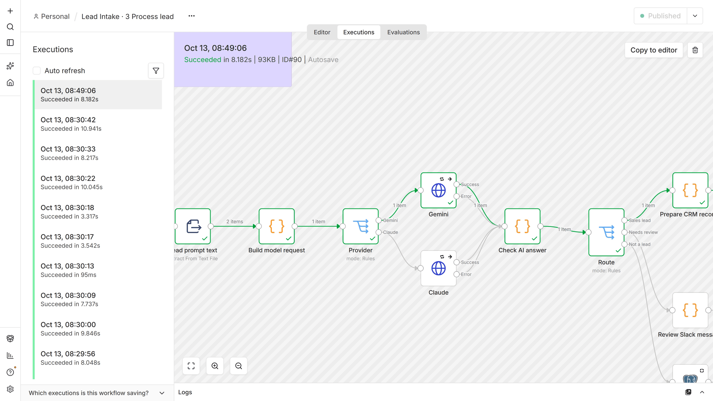<br><sub>n8n: the model call</sub></td>
    <td width="33%">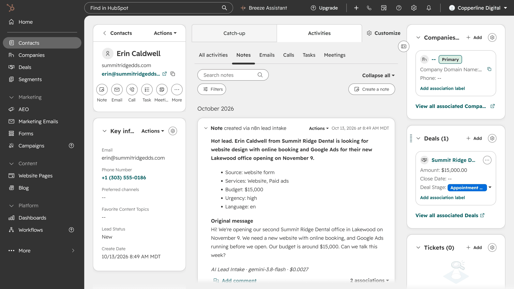<br><sub>HubSpot: contact, deal and note</sub></td>
    <td width="33%">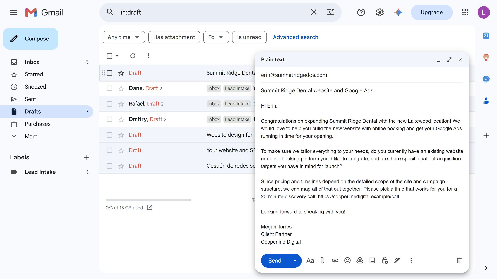<br><sub>Gmail: the reply draft</sub></td>
  </tr>
  <tr>
    <td>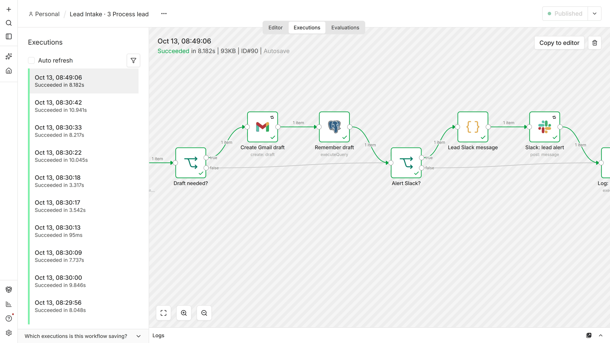<br><sub>n8n: through the draft and the Slack alert</sub></td>
    <td>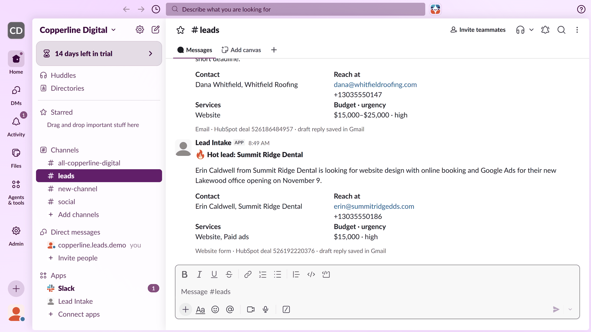<br><sub>Slack: the hot-lead alert</sub></td>
    <td>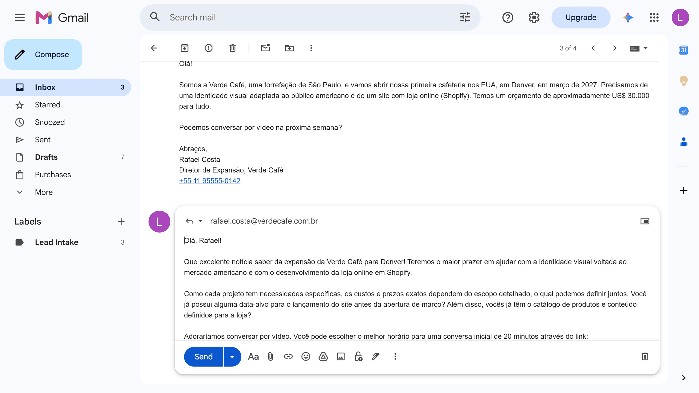<br><sub>A Portuguese lead, answered in Portuguese</sub></td>
  </tr>
</table>

**Choosing the model.** Six models read the same 30 test leads, 3 times each. Half are deliberately hard: spam that
looks like a lead and a lead written like spam, forwarded emails, budgets like "around 20 grand", deadlines like
"before Black Friday", Spanish, Portuguese, Russian and Spanglish, two prompt injections. Fields were checked by code;
drafts were judged by Claude Opus 5 and Gemini 3.1 Pro on a 7-point checklist, shuffled and anonymized.

| Model | All fields correct | Draft checks passed | Cost per lead | Median time |
|---|---|---|---|---|
| **Gemini 3.8 Flash** (default) | **98% ± 3** | **99%** | **$0.0024** | **2.3 s** |
| Claude Opus 5.5 | 100% | 100% | $0.0218 | 6.0 s |
| Claude Sonnet 5 | 74% ± 15 | 97% | $0.0106 | 6.0 s |
| Gemini 3.5 Flash-Lite | 71% ± 16 | 98% | $0.0013 | 1.9 s |
| Gemini 3.1 Flash-Lite | 69% ± 16 | 99% | $0.0009 | 2.1 s |
| Claude Haiku 4.5 | 61% ± 16 | 92% | $0.0041 | 4.2 s |

Smaller models mostly failed on relative deadlines ("before Black Friday", 66 days away, is not urgent) and on drafts
that promise ("tight but doable"). The cases, runner, graders, raw results and summary are in `eval/`
(`eval/runs/summary.md`).

**What was solved.** Every message gets a dedupe key (the Gmail message id, or a hash of the form's email, phone and
normalized text), and one SQL statement claims it as new, duplicate or retry. Each step saves its result on the lead
row, so a retry picks up where the last attempt stopped; a form sent twice and a lead that failed twice still left one
contact, one deal and one draft. The model's JSON is validated again, and a malformed, refused or truncated answer
goes to Slack instead of failing the workflow. A follow-up from a sender with a recent deal is added to that deal.

**Cost per lead**, measured in the workflow at September 2026 list prices: about $0.0026 with Gemini 3.8 Flash and
$0.025 with Claude Opus 5.5.

**Tests.** 10 test leads in `test-leads/` (English, Spanish, Portuguese, Russian; spam, an SEO pitch, an injection,
a duplicate, a follow-up). `node scripts/send-test-leads.mjs --report` sends them through the real entry points and
prints the log.

**Running v1** locally with Docker: copy `.env.example` to `.env` and fill it in, `docker compose up -d`, create the
n8n owner at http://localhost:5678, `node scripts/setup-credentials.mjs`, sign in with Google on the "Gmail (agency
inbox)" credential, then `bash scripts/deploy-workflows.sh LeadIntakeForm01 LeadIntakeProc01 LeadIntakeErrs01
LeadIntakeGmail1`. The contact form is at http://localhost:8080. The model switch is `provider` in the **Config**
node of *3 Process lead*.

## Later

Ideas kept out of the demo on purpose, and known gaps:

- SMS, and phone calls with a voice AI
- Reading photos, voice notes and documents; today Ava sees only that one was sent
- A typing indicator on WhatsApp (Telegram and the website chat show one)
- Messenger and Instagram for everyone: needs Meta's App Review and business verification
- Meeting names in the lead's language: a Spanish reminder still names the meeting in English
- Offering times in the very first reply when the first message already says everything; the calendar is read once
  the type of request is known, so times come from the second reply
- Rate limits on WhatsApp and Telegram (the website chat and form have them)
- "Delete my data" handled in code; today the team removes the person with `assistant.forget_contact()`
- An LLM judge for tone in the conversation eval, as v1 has, and scenarios where the team replies
- Assigning the CRM deal to the agent who holds the meeting
- Automatic fallback to the other model provider when one is down
- v1: a fast pre-filter model for high-volume inboxes, a scheduled retry for failed leads, HubSpot custom properties
  instead of a note

## License

[MIT](LICENSE)
